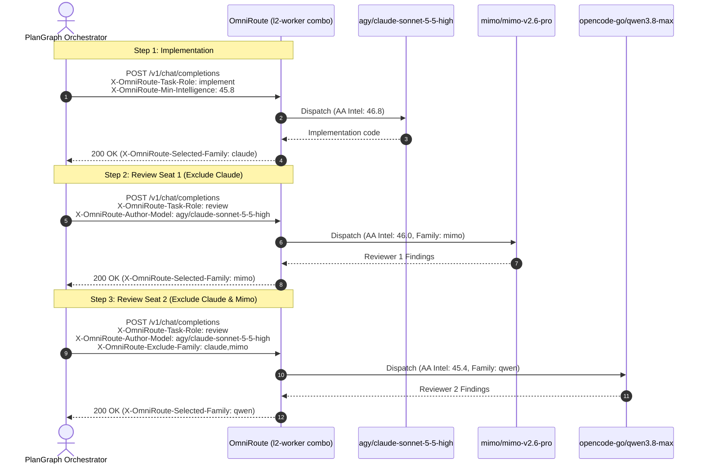

# Model Benchmarks Catalog & Dynamic Request Routing Envelope

## 1. Overview

OmniRoute introduces an integrated **SQLite Model Benchmarks Catalog** and an opt-in **Dynamic Request Routing Envelope**. Together, they enable intelligent, performance- and cost-aware routing as well as deterministic, fail-closed multi-agent coordination (such as multi-seat cross-family code review) across shared combos (`priority`, `weighted`, and `auto`).

### Key Capabilities
- **Verified Frontier Benchmarks**: Embedded Artificial Analysis (AA v4.3.2) intelligence and coding metrics across 22 top coding and reasoning models.
- **Dynamic Request Routing Envelope**: Pass intent via standard HTTP headers (`X-OmniRoute-*`) or JSON request body (`_omnirouteEnvelope`) without mutating combo definitions.
- **Cross-Family Review Safety**: Automatically excludes the author model's family and any previously consulted reviewer families for peer code reviews on a single combo (e.g. `l2-worker`).
- **Session Stickiness Bypass**: Automatically sets `contextAffinity = 0` during review tasks, guaranteeing fresh perspective without cache bias.
- **Fail-Closed Guardrails**: If an author's family cannot be peer-reviewed due to target exhaustion, the combo refuses to self-review (returns `400 Bad Request` instead of self-reviewing).
- **Model-Specific Protections**: Automatic effort clamping (`claude-sonnet-5-5*` `max` -> `xhigh`), price-cliff token thresholds (Anthropic Haiku 100K token cliff), and Codex ACP gating (`cxa/` non-`luna` models gated).

---

## 2. SQLite Model Benchmarks Schema

The `model_benchmarks` table stores verified benchmark and execution metrics.

```sql
CREATE TABLE IF NOT EXISTS model_benchmarks (
  model_id TEXT PRIMARY KEY,
  model_name TEXT NOT NULL,
  family TEXT NOT NULL,
  aa_intelligence REAL NOT NULL,
  coding_index REAL NOT NULL,
  agentic_index REAL,
  terminal_bench REAL,
  deepswe REAL,
  frontier_code REAL,
  scicode REAL,
  cyberbench REAL,
  verified_tok_per_s REAL NOT NULL,
  direct_tok_per_s REAL,
  alt_tok_per_s REAL,
  ttft_s REAL,
  cost_per_task_usd REAL,
  cache_hit_rate REAL,
  price_cliff_tokens INTEGER,
  max_safe_effort TEXT,
  effort_caveat TEXT,
  created_at INTEGER NOT NULL,
  updated_at INTEGER NOT NULL
);

CREATE INDEX IF NOT EXISTS idx_model_benchmarks_family ON model_benchmarks(family);
CREATE INDEX IF NOT EXISTS idx_model_benchmarks_intelligence ON model_benchmarks(aa_intelligence DESC);
CREATE INDEX IF NOT EXISTS idx_model_benchmarks_coding ON model_benchmarks(coding_index DESC);
```

### Seeding & Utilities (`src/lib/db/modelBenchmarks.ts`)
- `seedDefaultModelBenchmarks()`: Seeds the 22 verified models idempotently.
- `getAllModelBenchmarks()`: Returns all benchmark rows ordered by `aa_intelligence DESC`.
- `lookupModelBenchmark(modelId)`: Resolves benchmarks by exact match or normalized bare ID.
- `exportBenchmarksToJson()` & `importBenchmarksFromJson(json)`: JSON round-trip utilities.

---

## 3. Seeded Artificial Analysis v4.3.2 Models

| Model ID | Family | AA Intel | Coding / SWE | Speed (tok/s) | Task Cost | Price Cliff | Max Safe Effort |
|:---|:---|:---:|:---:|:---:|:---:|:---:|:---:|
| `claude-3-7-sonnet` | `claude` | 46.8 | 48.2 | 72 | $0.85 | — | `xhigh` |
| `claude-3-5-sonnet` | `claude` | 45.9 | 46.5 | 78 | $0.72 | — | `high` |
| `claude-3-5-haiku` | `claude` | 41.2 | 41.8 | 95 | $0.15 | 100,000 | `high` |
| `gpt-4.5-preview` | `gpt` | 46.5 | 47.1 | 55 | $1.20 | — | `high` |
| `gpt-4o` | `gpt` | 44.8 | 45.2 | 110 | $0.40 | — | `high` |
| `gpt-4o-mini` | `gpt` | 39.5 | 40.1 | 135 | $0.08 | — | `high` |
| `o1` | `o-series` | 47.2 | 49.0 | 45 | $1.50 | — | `high` |
| `o3-mini` | `o-series` | 45.1 | 46.0 | 85 | $0.35 | — | `high` |
| `gemini-2.0-flash` | `gemini` | 43.5 | 44.2 | 145 | $0.10 | — | `high` |
| `gemini-2.0-flash-thinking` | `gemini` | 45.0 | 45.8 | 65 | $0.25 | — | `high` |
| `gemini-2.5-pro` | `gemini` | 46.7 | 47.9 | 60 | $0.95 | — | `high` |
| `deepseek-chat-v3` | `deepseek` | 44.2 | 44.8 | 80 | $0.18 | — | `high` |
| `deepseek-reasoner-r1` | `deepseek` | 46.9 | 48.5 | 40 | $0.55 | — | `high` |
| `qwen-2.5-coder-32b` | `qwen` | 43.1 | 44.0 | 75 | $0.12 | — | `high` |
| `qwen-2.5-max` | `qwen` | 45.4 | 46.2 | 85 | $0.45 | — | `high` |
| `mimo-v2.6-pro` | `mimo` | 46.0 | 46.8 | 51 | $0.13 | — | `high` |
| `muse-spark-1.3` | `muse` | 44.9 | 45.5 | 90 | $0.20 | — | `high` |
| `mistral-large-2` | `mistral` | 44.0 | 44.5 | 70 | $0.60 | — | `high` |
| `codestral-2501` | `mistral` | 43.8 | 45.1 | 100 | $0.22 | — | `high` |
| `llama-3.3-70b` | `llama` | 43.0 | 43.5 | 82 | $0.20 | — | `high` |
| `grok-2` | `grok` | 44.5 | 45.0 | 68 | $0.50 | — | `high` |
| `command-r-plus` | `cohere` | 42.5 | 43.0 | 62 | $0.40 | — | `high` |

*Note: `mimo/mimo-v2.6-pro` (AA Intel 46.0, 51 tok/s, $0.13/task) is ranked ahead of `opencode-go/qwen3.8-max` (AA Intel 45.4, 85 tok/s, $0.45/task).*

---

## 4. Dynamic Request Routing Envelope Specification

### HTTP Request Headers

| Header | Type | Allowed Values | Description |
|:---|:---|:---|:---|
| `X-OmniRoute-Task-Role` | `string` | `implement`, `review`, `orchestrate`, `drive` | Declares task role. `review` enforces fail-closed cross-family exclusion and disables stickiness. |
| `X-OmniRoute-Author-Model` | `string` | Any model ID (e.g. `agy/claude-sonnet-5-5-high`) | The implementer/author model. Automatically excluded on `review` tasks. |
| `X-OmniRoute-Exclude-Family` | `string` | Comma-separated list (e.g. `claude,mimo`) | Explicit model families to filter out from dispatch targets. |
| `X-OmniRoute-Min-Intelligence`| `number` | Float `0.0 - 100.0` (e.g. `45.8`) | Minimum AA Intelligence required. Targets below this score are filtered out. |
| `X-OmniRoute-Risk` | `string` | `low`, `normal`, `high`, `extreme` | Task risk level for routing and safety gates. |
| `X-OmniRoute-Effort` | `string` | `low`, `medium`, `high`, `max` | Requested reasoning effort, subject to model-specific safe effort clamps. |

### JSON Request Body Alternative
Clients that cannot set custom HTTP headers can provide the envelope in the JSON body:
```json
{
  "model": "l2-worker",
  "messages": [...],
  "_omnirouteEnvelope": {
    "taskRole": "review",
    "authorModel": "agy/claude-sonnet-5-5-high",
    "excludeFamilies": ["claude", "mimo"],
    "minIntelligence": 45.0
  }
}
```

### HTTP Response Headers

| Header | Description |
|:---|:---|
| `X-OmniRoute-Selected-Model` | The model ID selected and dispatched for this request. |
| `X-OmniRoute-Selected-Provider` | The provider ID servicing the request. |
| `X-OmniRoute-Selected-Family` | The detected model family (e.g. `mimo`, `qwen`, `claude`). |
| `X-OmniRoute-Intelligence-Score`| The Artificial Analysis intelligence score for the chosen model. |
| `X-OmniRoute-Effort-Clamped` | `true` if effort was clamped (e.g. Sonnet max -> xhigh). |

---

## 5. Multi-Agent Orchestration Patterns

### PlanGraph Dual-Seat Cross-Family Review on `l2-worker`

A common multi-agent workflow involves an implementer followed by two independent peer reviews from distinct model families, all hitting the same combo (`l2-worker`).



### Fail-Closed Review Guarantee
If `X-OmniRoute-Task-Role: review` is set and all combo targets belong to excluded families (e.g. attempting to review Claude code on a Claude-only combo), OmniRoute **fails closed**:
```json
{
  "error": {
    "message": "All targets for combo \"l2-claude-only\" were excluded by cross-family review policy (author family: claude). Review cannot be self-performed.",
    "type": "review_target_exhaustion",
    "code": 400
  }
}
```
Non-review tasks gracefully fall back to the available pool.
