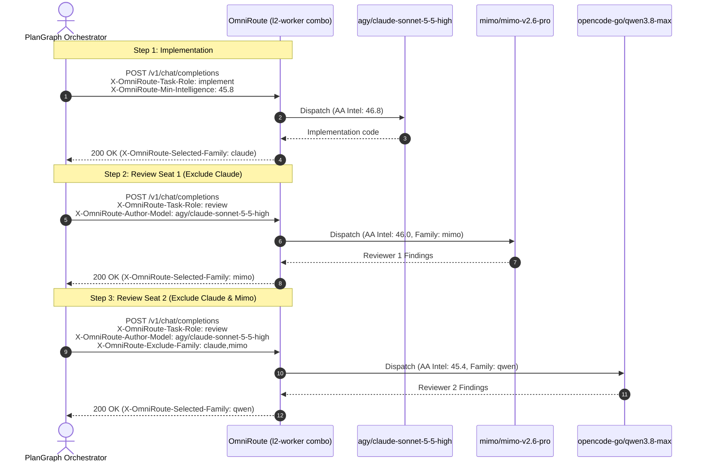

# Model Benchmarks Catalog & Dynamic Request Routing Envelope

## 1. Overview

OmniRoute introduces an integrated **SQLite Model Benchmarks Catalog** and an opt-in **Dynamic Request Routing Envelope**. Together, they enable intelligent, performance- and cost-aware routing as well as deterministic, fail-closed multi-agent coordination (such as multi-seat cross-family code review) across shared combos (`priority`, `weighted`, and `auto`).

### Key Capabilities
- **Verified Frontier Benchmarks**: Embedded Artificial Analysis (AA v4.3.2) intelligence and coding metrics across 22 top coding and reasoning models.
- **Dynamic Request Routing Envelope**: Pass intent via standard HTTP headers (`X-OmniRoute-*`) or JSON request body (`_omnirouteEnvelope`) without mutating combo definitions.
- **Cross-Family Review Safety**: Automatically excludes the author model's family and any previously consulted reviewer families for peer code reviews on a single combo (e.g. `l2-worker`).
- **Session Stickiness Bypass**: Automatically sets `contextAffinity = 0` during review tasks, guaranteeing fresh perspective without cache bias.
- **Fail-Closed Guardrails**: If an author's family cannot be peer-reviewed due to target exhaustion, the combo refuses to self-review (returns `400 Bad Request` instead of self-reviewing).
- **Model-Specific Protections**: Automatic effort clamping (`claude-sonnet-5-5*` `max` -> `xhigh`), price-cliff token thresholds (Anthropic Haiku 100K token cliff), and Codex ACP gating (`cxa/` non-`luna` models gated).

---

## 2. SQLite Model Benchmarks Schema (`213_model_benchmarks.sql`)

The `model_benchmarks` table stores verified benchmark and execution metrics in OmniRoute's SQLite database:

```sql
CREATE TABLE IF NOT EXISTS model_benchmarks (
  model_id TEXT PRIMARY KEY,
  family TEXT NOT NULL,
  aa_intelligence REAL NOT NULL,
  coding_index REAL,
  agentic_index REAL,
  terminal_bench REAL,
  deepswe REAL,
  frontier_code REAL,
  scicode REAL,
  cyberbench REAL,
  verified_tok_per_s REAL NOT NULL,
  direct_tok_per_s REAL,
  alt_tok_per_s REAL,
  ttft_s REAL,
  cost_per_task_usd REAL NOT NULL,
  cache_hit_rate REAL,
  price_cliff_tokens INTEGER,
  max_safe_effort TEXT,
  effort_caveat TEXT,
  benchmark_source TEXT NOT NULL DEFAULT 'AA-v4.3.2-2026-10',
  updated_at TEXT NOT NULL DEFAULT (datetime('now'))
) WITHOUT ROWID;

CREATE INDEX IF NOT EXISTS idx_mb_family
  ON model_benchmarks (family);

CREATE INDEX IF NOT EXISTS idx_mb_intelligence
  ON model_benchmarks (aa_intelligence DESC);
```

### Seeding & Utilities (`src/lib/db/modelBenchmarks.ts`)
- `seedDefaultModelBenchmarks()`: Seeds the 22 verified AA v4.3.2 models idempotently (`INSERT OR IGNORE`).
- `listModelBenchmarks()`: Returns all benchmark rows ordered by `aa_intelligence DESC, verified_tok_per_s DESC`.
- `getModelBenchmark(modelId)` / `lookupModelBenchmarkFromMap(modelId, map)`: Resolves benchmarks by exact `provider/model` or bare `model` ID in $O(1)$.
- `exportBenchmarksToJson()` & `importBenchmarksFromJson(json)`: Deterministic JSON converter utilities for external sync.

---

## 3. Seeded Artificial Analysis v4.3.2 Models (22 Entries)

| Rank | Model ID | Family | AA Intel | Key Coding / SWE Metric | Verified Speed (tok/s) | Task Cost (USD) | Price Cliff | Max Safe Effort |
|:---:|:---|:---|:---:|:---|:---:|:---:|:---:|:---:|
| 1 | `claude-opus-5-5-high` | `claude` | 57.6 | Term-Bench 60.0%, DeepSWE 74.2% | 98 | $1.82 | — | — |
| 2 | `gemini-4-argon-high` | `gemini` | 53.0 | DeepSWE 77.9%, Term-Bench 57.0% | 115 | $1.99 | — | — |
| 3 | `gpt-6-astra-max` | `gpt` | 53.0 | Coding Index 62.0 | 69 | $3.26 | — | — |
| 4 | `gpt-6-sol-max` | `gpt` | 52.0 | Coding Index 60.0 | 60 | $0.72 | — | — |
| 5 | `claude-sonnet-5-5-xhigh` | `claude` | 51.9 | Term-Bench 70.6%, FrontierCode 52.1% | 114 | $1.12 | — | `xhigh` |
| 6 | `gpt-6-sol-xhigh` | `gpt` | 51.0 | High-precision repo refactor | 56 | $0.39 | — | — |
| 7 | `gpt-6-sol-high` | `gpt` | 50.0 | Fast multi-file coding | 51 | $0.32 | — | — |
| 8 | `gpt-6-sol-medium` | `gpt` | 48.0 | Standard implementation | 47 | $0.21 | — | — |
| 9 | `claude-sonnet-5-5-high` | `claude` | 46.8 | Code Migration 69.8%, IOI 83.1% | 100 | $1.12 | — | `xhigh` |
| 10 | **`mimo-v2.6-pro`** | **`mimo`** | **46.0** | **#1 Open-Weights Coding Agent** | **51** (29 direct) | **$0.13** | — | — |
| 11 | **`qwen3.8-max`** | **`qwen`** | **45.4** | General reasoning & coding | **85** | **$0.45** | — | — |
| 12 | `muse-spark-1.3-contributor` | `muse` | 45.0 | Coding Index 75.8, Agentic 55.5 | 287 | $1.37 | — | — |
| 13 | `deepseek-v4-flash-max` | `deepseek` | 45.0 | High-throughput open-weights | 231 (380 alt) | $0.26 | — | — |
| 14 | `glm-5.2-max` | `glm` | 45.0 | Coding Index 71.5, SciCode 52.0% | 90 (170 alt) | $0.18 | — | — |
| 15 | `kimi-k3-max` | `kimi` | 44.0 | Long-context reasoning | 43 | $2.00 | — | — |
| 16 | `claude-haiku-4-5` | `claude` | 43.4 | Term-Bench 39.2% | 130 | $0.21 | 100,000 | — |
| 17 | `gpt-6-sol-low` | `gpt` | 42.0 | Lightweight Codex leg | 46 | $0.13 | — | — |
| 18 | `gemini-3.8-flash-tiered-high` | `gemini` | 41.0 | High-volume subagent discovery | 158 | $1.24 | — | — |
| 19 | `claude-sonnet-5-5-medium` | `claude` | 40.8 | Medium-effort Claude leg | 105 | $0.55 | — | `xhigh` |
| 20 | `qwen3.8-flash-next` | `qwen` | 40.0 | Fast zero-cost coding | 300 | $0.00 | — | — |
| 21 | **`gpt-6-luna-high`** | **`gpt`** | **38.4** | **Active Codex ACP (`cxa`) leg** | **180** | **$0.07** | — | — |
| 22 | `mimo-v2.6-flash` | `mimo` | 37.9 | CyberBench 75.4% | 54 (29 direct / 66.5 alt) | $0.04 | — | — |

*Note: `mimo/mimo-v2.6-pro` (AA Intel 46.0, 51 tok/s overall / 29 tok/s direct, \$0.13/task, 92.4% cache hit rate) is ranked ahead of `opencode-go/qwen3.8-max` (AA Intel 45.4, 85 tok/s, \$0.45/task).*

---

## 4. Dynamic Request Routing Envelope Specification

### HTTP Request Headers

| Header | Type | Allowed Values | Description |
|:---|:---|:---|:---|
| `X-OmniRoute-Task-Role` | `string` | `implement`, `review`, `orchestrate`, `drive` | Declares task role. `review` enforces fail-closed cross-family exclusion and disables stickiness. |
| `X-OmniRoute-Author-Model` | `string` | Any model ID (e.g. `agy/claude-sonnet-5-5-high`) | The implementer/author model. Automatically excluded on `review` tasks. |
| `X-OmniRoute-Exclude-Family` | `string` | Comma-separated list (e.g. `claude,mimo`) | Explicit model families to filter out from dispatch targets. |
| `X-OmniRoute-Min-Intelligence`| `number` | Float `0.0 - 100.0` (e.g. `45.8`) | Minimum AA Intelligence required. Targets below this score are filtered out. |
| `X-OmniRoute-Risk` | `string` | `low`, `normal`, `high`, `extreme` | Task risk level for routing and safety gates. |
| `X-OmniRoute-Effort` | `string` | `low`, `medium`, `high`, `max` | Requested reasoning effort, subject to model-specific safe effort clamps. |

### JSON Request Body Alternative
Clients that cannot set custom HTTP headers can provide the envelope in the JSON body:
```json
{
  "model": "l2-worker",
  "messages": [...],
  "_omnirouteEnvelope": {
    "taskRole": "review",
    "authorModel": "agy/claude-sonnet-5-5-high",
    "excludeFamilies": ["claude", "mimo"],
    "minIntelligence": 45.0
  }
}
```

### HTTP Response Headers

| Header | Description |
|:---|:---|
| `X-OmniRoute-Selected-Model` | The model ID selected and dispatched for this request. |
| `X-OmniRoute-Selected-Provider` | The provider ID servicing the request. |
| `X-OmniRoute-Selected-Family` | The detected model family (e.g. `mimo`, `qwen`, `claude`). |
| `X-OmniRoute-Intelligence-Score`| The Artificial Analysis intelligence score for the chosen model. |
| `X-OmniRoute-Effort-Clamped` | `true` if effort was clamped (e.g. Sonnet max -> xhigh). |

---

## 5. Multi-Agent Orchestration Patterns

### PlanGraph Dual-Seat Cross-Family Review on `l2-worker`

A common multi-agent workflow involves an implementer followed by two independent peer reviews from distinct model families, all hitting the same combo (`l2-worker`).



### Fail-Closed Review Guarantee
If `X-OmniRoute-Task-Role: review` is set and all combo targets belong to excluded families (e.g. attempting to review Claude code on a Claude-only combo), OmniRoute **fails closed**:
```json
{
  "error": {
    "message": "All targets for combo \"l2-claude-only\" were excluded by cross-family review policy (author family: claude). Review cannot be self-performed.",
    "type": "review_target_exhaustion",
    "code": 400
  }
}
```
Non-review tasks gracefully fall back to the available pool.
